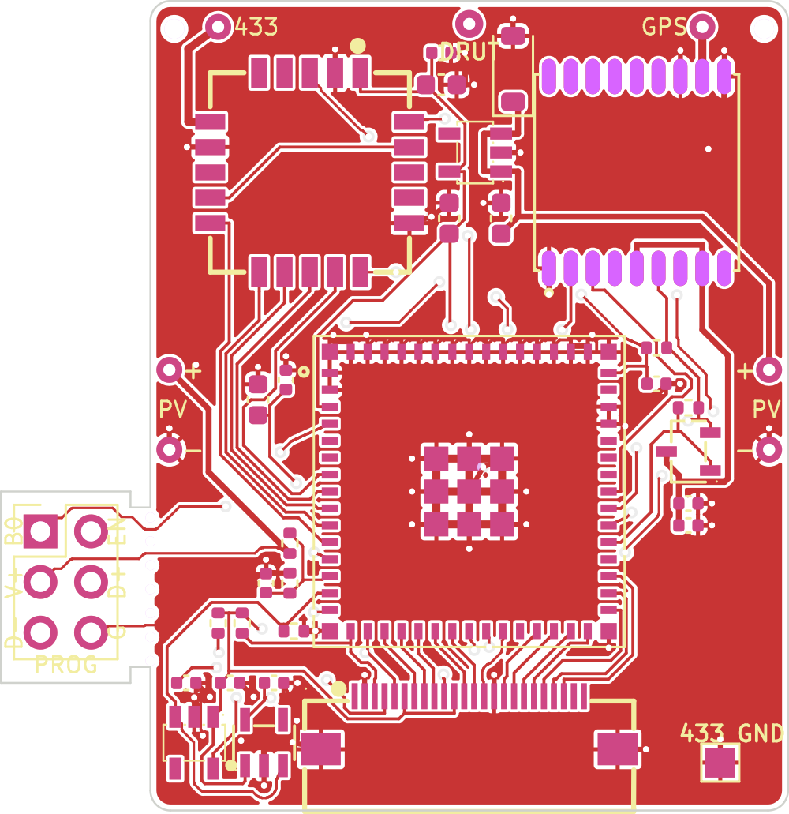

# GOLt433 - 433 MHz LoRa APRS balloon tracker with a camera

Board name on the PCB and in the files: **T433 lite**.

Sends position as a normal LoRa APRS frame on 433.775 MHz (SF12, BW 125 kHz) and photos as SSDV packets in APRS
"user-defined" frames (`{{I` + base91, the Pecan Pico format), so LoRa APRS iGates can pass them to APRS-IS.

**Status (2026-11-23): five v1.0 boards built by JLCPCB. Radio, GPS and camera work on the bench. Never flown, never tested
through a public iGate.**

## Hardware v1.0 (`pcb_lite/`)
- ESP32-S3-MINI-1U-N4R2, E22-400MM22S (SX1268, **crystal, not TCXO**), ATGM336H, OV2640 on a 24-pin FPC connector,
  ME6211C33 LDO, camera LDOs switched by a GPIO. 2 layers, everything on top, 32 x 40.6 mm, break-off PROG tab.
- Measured mass: 5.2 g without antennas, camera and solar cells.
- `kicad/` - KiCad 7 board; `jlcpcb/` - Gerbers, BOM, CPL; the Python/shell scripts are the generator used to build and route the board.
- Drawings in `img/` (Polish): USB cable on the PROG tab, where to solder antennas and cells, the FFC workaround.

### Camera connector J1 - top contact
J1 in the BOM is **AFC07-S24ECA-00 (LCSC C262643, top contact)**: the camera goes in lens down, contacts up.
The first five boards were built with a bottom-contact connector, which mirrors the pin order (camera pin 1 on pad 24):
the camera gets hot and does not work. That part has been removed from the BOM. If you have such a board, use an
FFC 24-pin 0.5 mm coupler plus a **type B** ribbon with the camera turned over (`img/T433_tasma_typ_B.png`).
- The footprint on the board is still the one drawn for the old connector. The signal pads are identical; the mounting
  tabs of the new part land on the existing pads, which are smaller than the tabs.
- The new body is about 1.5 mm longer: 0.1-0.4 mm from U7 and about 0.3 mm over the board edge. Check the placement preview.
- **A board with this connector has not been built yet.** A corrected layout (connector moved and rotated) is planned.

Other notes: the E22 crystal drifts about 40 Hz/s during the first seconds of transmission, so the first SF12 frames after
a cold start are lost (firmware sends warm-up frames). A module with a TCXO would be better.

## Firmware (`firmware/`)
- `tracker433_lite_v0_6/` - tracker. 640x480 photo, position frame repeated during the photo, warm-up frames,
  **photo resume after a power dropout** (JPEG and progress kept in LittleFS), waiting for sun when the panel voltage sags,
  position hidden below `POZYCJA_MIN_WYS_M` (only the 4-character locator is sent near the ground).
  Warm-up and resume were confirmed on hardware with v0.4/v0.5; **v0.6 itself is compiled only.**
- `tracker433_lite_rx_v0_1/` - a second T433 board as a USB receiver (prints every frame as a `T433RX;...` line).
- `hw_tests/` - bench test sketches (frames at different power, cold start, camera connector lines).
- Build: Arduino core esp32 3.0.7, board "ESP32S3 Dev Module", PSRAM enabled, Flash 4 MB, USB CDC On Boot enabled,
  RadioLib 7.1.2, TinyGPSPlus 1.1.0:
  `arduino-cli compile --fqbn "esp32:esp32:esp32s3:PSRAM=enabled,FlashSize=4M,CDCOnBoot=cdc,PartitionScheme=default" tracker433_lite_v0_6`
- Set `ZNAK` and `SSDV_ZNAK` in `config.h` to your callsign first.
- Flashing: USB on the PROG tab (V+ through a diode); first time hold B0 to ground at power-up; then upload with arduino-cli or esptool (no prebuilt images here, they would carry a callsign).

## PC receiver (`receiver_pc/`)
`t433_usb_odbior_v0_5.py` (needs `pyserial`) reads the receiver board over USB, shows frames and assembles photos.
It needs an SSDV decoder next to it: build `ssdv_dek_windows.c` with `ssdv.c` and `rs8.c` from the tracker folder.

## Not tested at all
Position frame from a real fix above 1000 m, waiting for sun, Zener protection with 8 cells, the path through public iGates and APRS-IS.

## Callsigns
`N0CALL` in the code is a placeholder. Set your own callsign before transmitting; an amateur licence is required.

## Related
GOLr20, the HF FT8/WSPR tracker with a receiver from the same author: https://github.com/Anakreont/GOLr20

## Licence
GPL-3.0 for the whole repository (see `LICENSE`). The firmware and the PC receiver include SSDV, Reed-Solomon and base91
code from Pecan Pico 9 by Philip Heron (GPL v3). Design by SQ9GOL. Source comments and drawings are in Polish.
